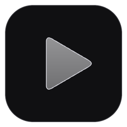

<p align="center"></p>

<h1 align="center">PlayTube</h1>

<p align="center">
<a href="https://github.com/lth1503ahihi/playtube/releases/latest"></a>
<a href="LICENSE"></a>
<a href="https://github.com/lth1503ahihi/playtube/stargazers"></a>
</p>

**YouTube được tái định nghĩa. Khác biệt trong thiết kế. Mượt mà trong từng chuyển động.** <br><br> **Ứng dụng tích hợp trọn vẹn cả video YouTube và nghe nhạc:** PlayTube dành cho video, và PlayTune — không gian âm nhạc chuyên nghiệp, chỉ cách bạn một cú chạm.<br><br> Hoàn toàn không quảng cáo. Không gián đoạn. Giao diện kính mờ Liquid Frosted Glass tuyệt đẹp, lời bài hát đồng bộ thời gian thực, phát trong nền và tải xuống chỉ với một chạm.<br><br> **Một trải nghiệm thưởng thức YouTube hoàn toàn mới mẻ.**<br><br>

<p align="center"></p>

<p align="center"><a href="https://github.com/lth1503ahihi/playtube/releases/latest"><b>⬇ Tải về phiên bản PlayTube mới nhất (ARM64)</b></a></p>

> [!IMPORTANT]
> PlayTube là ứng dụng độc lập, không liên kết, tài trợ hay trực thuộc YouTube hoặc Google dưới bất kỳ hình thức nào. Ứng dụng được phát triển cho mục đích trải nghiệm cá nhân.

---

## Tính năng nổi bật

<table>
<tr>
<td width="25%"></td>
<td width="25%"></td>
<td width="50%">

### PlayTune - Không gian âm nhạc chuyên nghiệp
Một ứng dụng cho cả video YouTube **và** YouTube Music. Chạm vào logo trên Trang chủ và PlayTube sẽ chuyển thành trình phát nhạc; chạm lại lần nữa để quay về video.

- 🎤 **PlayTune AI Karaoke:** Tách giọng hát ca sĩ trực tiếp ngay trên điện thoại bằng mô hình YkAI, thỏa sức hát karaoke offline mà không cần tải dữ liệu lên máy chủ.
- 🎧 **PlayTuneMix:** Hòa âm chuyển bài liền mạch như DJ. Bài hát trước tự động mờ dần ở đoạn kết và bài tiếp theo mượt mà nối tiếp, không bị ngắt quãng hay giật âm lượng.
- **Kho nhạc trọn vẹn:** Đầy đủ Trang chủ, Khám phá, Thư viện và Tìm kiếm của YouTube Music cùng các album, nghệ sĩ, danh sách phát, tâm trạng và bài hát yêu thích.
- **Trình phát nhạc cao cấp:** Lời bài hát chạy chữ đồng bộ, ảnh bìa chuyển động sống động, định dạng âm thanh hiển thị trên thanh kính mờ và radio tự động nối bài.
- **Âm thanh vòm sống động:** Tích hợp lõi **Rust Native DSP Core (ARM64 SIMD)** cùng thuật toán mô hình đầu người MIT KEMAR, chế độ Cinema tăng cường âm trầm, hỗ trợ theo dõi chuyển động đầu trên Android 13+, Dolby Atmos và hồ sơ tai nghe AutoEq.
- **Chất lượng theo ý muốn:** Tùy chọn chất lượng âm thanh riêng biệt cho Wi-Fi và mạng di động 4G/5G, tinh chỉnh tốc độ phát bài hát (0.25x đến 4x với bước nhảy 0.01x).
- **Phát nhạc mọi nơi:** Lưu trữ ngoại tuyến kèm lời bài hát, phát ngay cả khi hoàn toàn mất mạng.
- **Không gian riêng biệt:** Lịch sử nghe, danh sách tải về và bộ chỉnh âm Equalizer độc lập hoàn toàn với bên video.

</td>
</tr>
<tr>
<td width="25%"></td>
<td width="25%"></td>
<td width="50%">

### Giao diện Liquid Glass hoặc Chế độ YouTube
Hiệu ứng kính mờ tinh tế trên thanh điều hướng, trình phát và mục Shorts, kết hợp cùng dải ánh sáng chuyển động theo từng tab bạn chọn. Video trên trang chủ tự động phát khi cuộn tới. Bạn thích giao diện quen thuộc? **Chế độ YouTube** sẽ ghim thanh điều hướng phẳng ở dưới cùng và đưa ô tìm kiếm lên đầu trang.

</td>
</tr>
<tr>
<td width="25%"></td>
<td width="25%"></td>
<td width="50%">

### Trình phát video thông minh, hiển thị nhiều hơn
Trang xem thu gọn bố trí các nút tương tác cạnh nút Đăng ký và hiển thị bình luận hàng đầu ngay dưới khung video. Biểu đồ **Đoạn được xem lại nhiều nhất (Most replayed)** hiển thị trực quan trên thanh thời gian, tua video có khung hình thu nhỏ chính xác. Thu phóng video mượt mà bằng 2 ngón tay lên đến **8x**.

</td>
</tr>
<tr>
<td width="25%"></td>
<td width="25%"></td>
<td width="50%">

### Lời bài hát đồng bộ & Bộ cân bằng âm thanh Equalizer
Video ca nhạc tự động hiển thị lời bài hát chạy chữ từng câu từ nguồn cung cấp bạn chọn. **Bộ cân bằng Equalizer** tích hợp sẵn ngay trong menu trình phát với nhiều cài đặt sẵn hoặc tự chỉnh các dải tần số trực tiếp, khuếch đại âm lượng lên tới 200%.

</td>
</tr>
<tr>
<td width="25%"></td>
<td width="25%"></td>
<td width="50%">

### Trang kênh đầy đủ & Bài đăng cộng đồng
Xem trọn vẹn kênh của nhà sáng tạo nội dung: video mới nhất, danh sách phát, video Shorts, buổi phát trực tiếp (Live) và các bài đăng cộng đồng (kèm hình ảnh, khảo sát bình chọn).

</td>
</tr>
<tr>
<td width="25%"></td>
<td width="25%"></td>
<td width="50%">

### Tìm kiếm giọng nói Song ngữ & Lịch sử tiện lợi
Tìm kiếm thông minh với gợi ý nhanh, bộ lọc linh hoạt và hỗ trợ **Tìm kiếm giọng nói chuẩn Tiếng Việt (`vi-VN`) & Song ngữ (`en-US`)**. Quản lý lịch sử xem cục bộ, dễ dàng tìm lại video đã xem hoặc tiếp tục phát từ vị trí tạm dừng.

</td>
</tr>
<tr>
<td width="25%"></td>
<td width="25%"></td>
<td width="50%">

### Tải ngoại tuyến chất lượng cao & Tối ưu vượt trội
- **Tải xuống ngoại tuyến:** Hỗ trợ tải video độ phân giải cao lên đến **4K (2160p)** và tải âm thanh riêng biệt kèm ảnh bìa album.
- **Shorts vào tức thì:** Loại bỏ độ trễ tải mạng, chuyển đến tab Shorts là video phát ngay lập tức.
- **Tần số quét 120Hz/90Hz:** Tự động kích hoạt tần số quét cao nhất của màn hình, cuộn lướt siêu mượt.
- **Tự động cập nhật trực tiếp:** Kiểm tra và nâng cấp phiên bản mới dễ dàng từ GitHub Releases của PlayTube.
- **100% Tiếng Việt:** Toàn bộ giao diện, tính năng và thông báo được bản địa hóa tự nhiên, chuẩn xác.

</td>
</tr>
</table>

---

## 🛠 Hướng dẫn Build từ mã nguồn

```bash
# 1. Clone repository kèm đầy đủ submodules
git clone --recursive https://github.com/lth1503ahihi/playtube.git
cd playtube

# 2. Build lõi Rust Native DSP Core cho ARM64
cargo install cargo-ndk
cd native/playtube-core
cargo ndk --platform 24 -t arm64-v8a -o ../../mobile/src/stmobile/jniLibs build --release
cd ../..

# 3. Build APK Debug
./gradlew :mobile:assembleStmobileDebug

# File APK tạo tại: mobile/build/outputs/apk/stmobile/debug/
```

---

## ❤️ Ủng hộ dự án PlayTube

PlayTube được phát triển và tối ưu liên tục nhằm đem lại trải nghiệm nghe nhạc, xem video mượt mà, hiện đại và hoàn toàn miễn phí cho người dùng.

⭐ Nếu bạn thấy PlayTube hữu ích, hãy tặng dự án **1 Star trên GitHub** hoặc chia sẻ ứng dụng tới bạn bè và người thân. Đó là nguồn động lực lớn nhất để PlayTube ngày càng hoàn thiện hơn!

<p align="center">
<a href="https://github.com/lth1503ahihi/playtube"></a>
</p>

---

## 🤝 Lời cảm ơn (Credits)

Chân thành cảm ơn các dự án mã nguồn mở tuyệt vời:
- [MeeTube](https://github.com/yashoncode/meetube) bởi [@yashoncode](https://github.com/yashoncode)
- [SmartTube](https://github.com/yuliskov/SmartTube) bởi [@yuliskov](https://github.com/yuliskov)
- [NewTube](https://github.com/aleixrodriala/newtube) bởi [@aleixrodriala](https://github.com/aleixrodriala)
- Hồ sơ cân bằng âm thanh tai nghe từ [AutoEq](https://github.com/jaakkopasanen/AutoEq) bởi [@jaakkopasanen](https://github.com/jaakkopasanen)
- Cùng toàn thể cộng đồng mã nguồn mở đã đóng góp ý kiến và bản vá.

---

## 📄 Giấy phép (License)

Dự án phát hành dưới giấy phép [MIT License](LICENSE).
